# gid=0 — feedback for web

Աղբյուր՝ [feedback for web, առաջին թերթ](https://docs.google.com/spreadsheets/d/1p79Zqe-LfEtn6zRITd0ahO-734C8b8S1NGg-wy5_Oak/edit?gid=0#gid=0)  
Աուդիտ՝ 2026-10-20, ըստ ընթացիկ կոդի։ `Neetrino comment` սյունը դատարկ է։

Տոկոսը պահանջի դեմ կոդի վիճակն է։ Շեմը՝ Done ≥ 90%, Partial 15–89%, Missing 0–14%։

**Ընդհանուր՝ 92%** (42 կետի միջին)։ Done 41, Partial 1, Missing 0։

Սքրինշոթները այս թղթապանակի `screenshots/`-ում են, կապված իրենց տողին։ Google-ի ներկառուցված նկարի հղումը ժամանակավոր է, դրա համար ֆայլերը պահված են տեղում։ Որոշ նկար թերթում կտրված է բջջի բարձրությամբ. նկարագրությունը հենվում է տեսանելի մասի վրա։

Ստուգումը՝ `http://localhost:3000`։

## Հակասություններ, որոնք չպետք է «ուղղել» կուրորեն

Այս թերթի մի քանի կետ հակասում է նույն թերթի վերջի մենյուի աղբյուրին և ավելի ուշ թերթերին։

| Կետ | Այս թերթը ասում է | Ինչն է գերակա հիմա |
|---|---|---|
| B3 | Art & Culture-ը խառնել More Culture-ի հետ | More Culture-ի կետերը Art & Culture սյան մեջ են, առանձին սյուն չկա |
| B4 | Museums-ը Architecture-ից տեղափոխել Art & Culture | Մենյուում Museums-ը Art & Culture-ում է։ Հասցեն մնում է `/culture/heritage/museums` |
| B2 և C6 | B2-ը հանում է partnership-ը գլխավորից, C6-ը ուզում է Partnership Icons Footer | Գլխավորում partnership շարքը կա, donation սեկցիա չկա |
| B22 | Newsletter-ը թաքցնել միայն մուտք գործածներին | Բլոկը գլխավորից հանված է բոլորի համար |

Ավելի ուշ թերթերը (`28.08`, `09.10`, card content) այս ֆայլի կետերը չեն փոխարինում, բայց նույն էկրանին հակասելիս գերակա է ավելի նոր թերթը։ Տես [`docs/FEEDBACK_SHEETS_OVERVIEW.md`](../FEEDBACK_SHEETS_OVERVIEW.md)։

---

## Ամփոփ աղյուսակ

| ID | Թերթի տող | Բաժին | Կարգավիճակ | % | Ստուգել |
|---|---:|---|---|---:|---|
| A1 | 2 | Քարտի տառատեսակ | Done | 90% | `/culture/item/[slug]` |
| A2 | 3 | Քարտի subtitle | Done | 90% | `/culture/architecture/churches` |
| A3 | 4 | Արևմտահայերեն | Done | 90% | լեզվի անջատիչ, `/admin/settings` |
| A4 | 5 | Անսահմանափակ մեդիա լինքեր | Done | 95% | `/admin/culture-items/[id]`, հոդված |
| A5 | 6 | Քարտեզը թաքցնել, եթե դատարկ է | Done | 95% | հոդված առանց կոորդինատի |
| A6 | 7 | Ենթաէջ → գլխավորի shortcut | Done | 95% | `/`, `/admin/culture-items` |
| A7 | 8 | Հանել նմանատիպ հատվածը | Done | 95% | հոդված |
| A8 | 9 | Նկարագրությունը միայն ներքևում | Done | 95% | `/culture/item/[slug]` |
| A9 | 10 | Կողքի բլոկը հանել, փիրուզը մեղմել | Done | 90% | հոդված |
| B1 | 15 | Հանել 4 feature քարտը | Done | 95% | `/`, `/virtual-museum` |
| B2 | 16 | Գլխավորի կառուցվածք | Done | 90% | `/` |
| B3 | 17 | Art & Culture + More Culture | Done | 90% | մենյու |
| B4 | 18 | Museums → Art & Culture | Done | 90% | մենյու, `/culture/heritage/museums` |
| B5 | 19 | Ենթաբաժնի էջ՝ առանց նկարագրության | Done | 95% | `/culture/heritage` |
| B6 | 20 | User-ը ոչինչ չավելացնի | Done | 95% | `/culture/submit` 404 |
| B7 | 21 | Epic | Done | 90% | `/culture/legends/epic` |
| B8 | 22 | Upcoming գումարները խմբագրելի | Done | 90% | `/admin/projects`, `/projects` |
| B9 | 23 | Why it matters + ամսական/տարեկան | Done | 95% | `/donate` |
| B10 | 24 | 1000 / 5000 / 10000 + սերտիֆիկատ | Done | 95% | `/donate` |
| B11 | 25 | Ընտրված ֆիլտրը մոխրագույն | Done | 95% | `/map` |
| B12 | 26 | Ցանկը քարտեզի ներսում, քարտեզը մեծ | Done | 95% | `/map` |
| B13 | 27 | Բլոգը աշխատի | Done | 95% | `/blog` |
| B14 | 28 | Միատոն սև ֆոն | Done | 90% | `/donate`, `/` |
| B15 | 29 | Sign in-ի տեղը | Done | 90% | `/login` |
| B16 | 30 | Upcoming-ի ենթակետերը հանել | Done | 95% | հեդերի Upcoming |
| B17 | 31 | Գործընկերների քարտեր, ոչ շրջան | Done | 95% | `/partnership` |
| B18 | 32 | Գրքի ներբեռնում | Done | 90% | `/#downloads` |
| B19 | 33 | Featured treasures խառը դասավորություն | Done | 95% | `/#` featured |
| B20 | 34 | Patron wall-ի փոխարեն սերտիֆիկատ | Done | 95% | `/donate` |
| B21 | 35 | Բլոգ՝ 3 highlighted + ժամանակագրություն | Done | 95% | `/blog` |
| B22 | 36 | Newsletter-ը գրանցվածներին չերևա | Done | 90% | `/` մուտքով և առանց |
| C1 | 38 | Մենյու ըստ կապված sheet-ի | Done | 90% | հեդերի Culture |
| C2 | 39 | Լոգոն մեծ, վահանը երևա | Done | 90% | հեդեր |
| C4 | 40 | Ոսկեգույն զարդանախշ իկոններ | Done | 90% | մենյու, կատալոգ |
| C5 | 41 | HY RU EN FR PT + enable/disable | Done | 90% | անջատիչ, `/admin/settings` |
| C6 | 42 | Գլխավորի սեկցիաների կարգ | Done | 90% | `/` |
| C7 | 43 | Կենդանի ֆոներ | Partial | 80% | `/` |
| C8 | 44 | Իմերսիվ քարտեզ | Done | 90% | `/map` |
| C11 | 45 | Մոբայլ | Done | 90% | `/` նեղ լայնք |
| C12 | 46 | Բաժինների կապը | Done | 90% | `/culture/architecture/churches` |
| C13 | 47 | News feed | Done | 90% | `/`, `/blog`, `/admin/blog` |
| C14 | 48 | Գրանցում | Done | 90% | `/register`, `/admin/users` |

---

## A — քարտեր

### A1 — Քարտի տառատեսակ

| | |
|---|---|
| Թերթ | տող 2, `card visuals` |
| % | 90% |
| Սքրինշ | 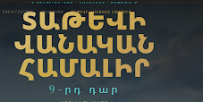 |

Պահանջ. տառատեսակը լինի նախնական դիզայնինը։ Եթե հայերեն գլիֆ չկա, վերցնել մոտիկը։

Սքրինշում երևում է `ՏԱԹԵՎԻ ՎԱՆԱԿԱՆ ՀԱՄԱԼԻՐ` ոսկեգույն, մուգ երկնքի վրա, տակը `9-րդ դար`։

Ինչպես է արված. լատինատառ քարտի վերնագիրը մնում է դիզայնի Cinzel-ը։ Cinzel-ը հայերեն չունի, դրա համար հայերեն վերնագիրը, դարի տողը և քարտի տեքստը գնում են Noto Serif Armenian-ի (մոտիկ սերիֆ)։ Քարտի անգլերեն նկարագրությունը Kelvinch է։ Կեղծ extra-bold (800/900) հայերենի վրա այլևս չի սինթեզվում. վերնագիրը իրական 700 է, դարի տողը՝ 500, առանց 0.2em նոսրացման։

Ստուգել. `/culture/architecture/churches` և գլխավորի Featured Treasures, հայերեն վերնագրով քարտ։ Տառը սերիֆ է, չի փշրվում։ Անգլերեն քարտի վերնագիրը Cinzel է մնում։ 100% չէ, որովհետև նախնական դիզայնի սեփական font ֆայլը չի տրվել։

Ֆայլեր. `app/globals.css`, `components/culture-catalog/culture-catalog-page.css`, `components/culture-catalog/CultureCatalogItemGrid.tsx`, `components/sections/featured-treasures/FeaturedTreasureCard.tsx`

### A2 — Subtitle քարտերում

| | |
|---|---|
| Թերթ | տող 3, `subtitle` |
| % | 90% |
| Սքրինշ | 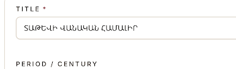 |

Պահանջ. card-երում ավելացնել subtitle հատված։

Սքրինշը ադմինի `TITLE` դաշտն է (`ՏԱԹԵՎԻ ՎԱՆԱԿԱՆ ՀԱՄԱԼԻՐ`) և տակը `PERIOD / CENTURY`։ Առանձին subtitle դաշտ չէր երևում։

Ինչպես է արված. `CultureItem.subtitle` պահվում է ըստ լեզվի, ինչպես վերնագիրը։ Ադմինում Title-ի կողքն է `Subtitle` դաշտը։ Կատալոգի քարտում այն նստում է վերնագրի տակ, շեղատառ, կարճ նկարագրությունից առաջ։ Եթե դաշտը դատարկ է, վերցվում է հոդվածի առաջին բլոկի subtitle-ը։ Եթե այդ տեքստը նույնն է, ինչ կարճ նկարագրությունը, կրկին չի դուրս գալիս։

Ստուգել. `/admin/culture-items/[id]` լրացնել Subtitle, պահպանել, բացել `/culture/architecture/churches`։ Վերնագրի տակ երևում է այդ տողը, տակը մնում է կարճ նկարագրությունը։ Դատարկ subtitle-ով քարտը չի կոտրվում։

Ֆայլեր. `prisma/schema.prisma`, `components/admin/culture-item-editor/CultureItemEditorMetaBar.tsx`, `components/culture-catalog/CultureCatalogItemGrid.tsx`

### A3 — Արևմտահայերեն

| | |
|---|---|
| Թերթ | տող 4, `language` |
| % | 90% |
| Սքրինշ | 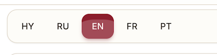 |

Պահանջ. ավելացնել արևմտահայերենը։

Սքրինշում անջատիչն է `HY · RU · EN · FR · PT`, ընտրված է EN։ Արևմտահայերենն այդ կտրվածքում չկար։

Ինչպես է արված. `HYW` կա լեզուների ցանկում և միացված է կայքի կարգավորումներում (`HY, HYW, EN, RU, FR, PT`)։ Անջատիչում կոդը `HYW` է, էջի լեզուն `hyw`։ Ինտերֆեյսի տեքստը դասական ուղղագրությամբ է (`և` → `եւ`, `ություն` → `ութիւն`, `Սյունիք` → `Սիւնիք`)։ Եթե նյութի արևմտահայերեն դաշտը դատարկ է, ցույց է տրվում արևելահայերենը նույն ուղղագրությամբ։ Ադմինը կարող է առանձին լրացնել Western դաշտը, և այդ տեքստը մնում է ինչպես գրված է։

Ստուգել. հեդերի անջատիչից ընտրել `HYW`, բացել `/`։ Մենյուում պետք է լինի `Նուիրատվութիւն`, ոչ թե `Նվիրատվություն`։ `HY` ընտրելիս արևելահայերենը մնում է առաջվանը։ Ադմին՝ `/admin/settings` և նյութի `ARM (W)` ներդիրը։

Ֆայլեր. `lib/i18n/western-armenian.ts`, `lib/i18n/message-row.ts`, `lib/i18n/translatable-content.ts`

### A4 — Լինքեր առանց քանակի սահմանի

| | |
|---|---|
| Թերթ | տող 5, `links` |
| % | 95% |
| Սքրինշ | չկա |

Պահանջ. քարտում լինի drone, Matterport, map, YouTube։ Քանակի սահման չլինի. որքան նկար, վիդեո, վիրտուալ տուր կամ դրոն պետք է, այնքան ավելացվի։

Ինչպես է արված. տուրի տեսակներն են LiDAR, 3D, Matterport, Drone։ Վիդեոն ընդունում է YouTube, Vimeo կամ MP4։ Քարտեզը `mapUrl` է։ Նկարները, տուրերը և վիդեոները ցուցակ են, առանց 20 կամ 30 հատի կտրվածքի։ Դատարկ տողը էջում չի դուրս գալիս։

Ստուգել. `/admin/culture-items/[id]` ավելացնել Matterport և Drone տուր, երկու YouTube վիդեո, պահպանել, բացել `/culture/item/[slug]`։ Բոլորը երևում են։

Ֆայլեր. `lib/culture-item-media.ts`, `lib/admin/culture-item-media-form.ts`, `components/culture-catalog/CultureItemPublicTour.tsx`

### A5 — Քարտեզ միայն եթե լրացված է

| | |
|---|---|
| Թերթ | տող 6, `map` |
| % | 95% |
| Սքրինշ | չկա |

Պահանջ. բոլոր քարտերը կարողանան քարտեզ ունենալ։ Եթե ադմինը չլրացնի, էջում չերևա։

Ինչպես է արված. ամեն նյութ ունի Map բաժին։ Առանց map link-ի և կոորդինատի Location բլոկը չի նկարվում։ Լրացված արտաքին հղումը երևում է նույնիսկ եթե կետը չի կորզվում։ `showOnMap` միայն ժառանգության քարտեզի pin-ն է։

Ստուգել. հոդված առանց map URL-ի՝ Location բլոկ չկա։ Լրացնելուց հետո բլոկը երևում է։ `/map`-ում pin-ը միայն նշվածներինն է։

Ֆայլեր. `components/culture-catalog/CultureItemPublicMap.tsx`, `components/admin/culture-item-editor/AdminLocationMapField.tsx`

### A6 — Ենթաէջը գլխավորի shortcut

| | |
|---|---|
| Թերթ | տող 7, `home page` |
| % | 95% |
| Սքրինշ | 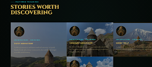 |

Պահանջ. ենթաէջերում լինի կոճակ, որով ադմինը միացնում է նյութը, և այն գլխավորում երևա shortcut-ով։

Սքրինշը գլխավորի `STORIES WORTH DISCOVERING` շարքն է. երեք քարտ նկարով, տարեթվով և վերնագրով։

Ինչպես է արված. `/admin/culture-items` ցանկում ամեն նյութ ունի `Home` / `On home` կոճակ։ Խմբագրիչում նույն դրոշը `Home shortcut` է, կարգը 1–5։ Հրապարակված նյութը գլխավորի Stories շարքում է։ Անջատելը հանում է այն։

Ստուգել. `/admin/culture-items` սեղմել `Home` հրապարակված նյութի վրա, բացել `/`։ Քարտը Stories շարքում է։ `On home` նորից սեղմելը հանում է այն։

Ֆայլեր. `components/admin/CultureItemsSortableList.tsx`, `app/(admin)/admin/(panel)/culture-items/actions.ts`

### A7 — Հանել նմանատիպ հատվածը

| | |
|---|---|
| Թերթ | տող 8 |
| % | 95% |
| Սքրինշ | 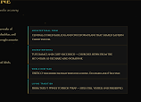 |

Պահանջ. «հեռացնել նմանատիպ հատվածները»։

Սքրինշը բարակ կտրվածք է. երևում է `ARCHITECTURAL FORM` և տակը ցանկի տողեր։ Հոդվածի կողքի կամ ներքևի կրկնվող բլոկ է, ոչ թե ամբողջ էջ։

Ինչպես է արված. հոդվածի էջում related շարք չկա։ Նույն բլոկը հանված է նաև `/khndzoresk`, `/national-gallery-armenia` և `/khachaturian-museum` էջերից։

Ստուգել. այդ երեք էջերի վերջում related ցանկ չկա։ `/culture/item/[slug]` վերջում միայն հետ գնալու հղումն է։

Ֆայլեր. `components/khndzoresk/KhndzoreskPage.tsx`, `components/national-gallery-armenia/NationalGalleryPage.tsx`, `components/khachaturian-museum/KhachaturianMuseumPage.tsx`

### A8 — Նկարագրությունը միայն ներքևում

| | |
|---|---|
| Թերթ | տող 9 |
| % | 95% |
| Սքրինշ | 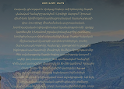 |

Պահանջ. նկարագրությունը վերնագրի տակ էլ է երևում։ Հանել այդը, թող մնա միայն ներքևինը։

Սքրինշում վերնագրի տակ երկար պարբերություն է՝ լեռների նկարի վրա։

Ինչպես է արված. hero-ին նկարագրություն այլևս չի փոխանցվում։ Տեքստը մնում է ներքևի description բլոկներում։

Ստուգել. `/culture/item/[slug]`։ Վերնագրի տակ, նկարի վրա, երկար պարբերություն չկա։ Նույն տեքստը էջի մարմնում է։

Ֆայլեր. `components/culture-catalog/CultureItemDetailView.tsx`

### A9 — Կողքի բլոկը հանել, փիրուզը մեղմել

| | |
|---|---|
| Թերթ | տող 10 |
| % | 90% |
| Սքրինշ | 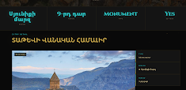 |

Պահանջ. նկարի կողքի հատվածը հանել, մնա միայն փիրուզագույն շարքը։ Տառատեսակը շատ կոպիտ է. ավելի նուրբ և մի քիչ փոքր, որ աչք չծակի։

Սքրինշում վերևում փիրուզով `Արագածոտն · 9-րդ դար · MONUMENT · YES` է, տակը վերնագիր, նկար, և աջ կողմում `KEY TAKEAWAYS`։

Ինչպես է արված. հոդվածում կողքի takeaways սյուն չկա։ Մետա շարքը մնում է, բայց հոդվածի վրա տառը 18px է և 500 հաստություն, առանց փիրուզ շողքի։ Մյուս էջերի վիճակագրությունը չի փոխվել։

Ստուգել. `/culture/item/[slug]` desktop։ Աջում takeaways չկա։ Փիրուզ թվերը ավելի մանր են, քան կատալոգի էջի վիճակագրությունը։

Ֆայլեր. `components/culture-catalog/CultureItemDetailView.tsx`, `components/culture-catalog/culture-catalog-page.css`

---

## B — էջերի կառուցվածք

### B1 — Հանել չորս feature քարտը

| | |
|---|---|
| Թերթ | տող 15, N 1, `remove` |
| % | 95% |
| Սքրինշ | 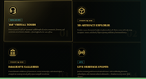 |

Պահանջ. «այս հատվածը հանում ենք»։

Սքրինշը չորս քարտ է. `3D VIRTUAL TOURS`, `3D ARTEFACT EXPLORER`, `IMMERSIVE GALLERIES`, `LIVE HERITAGE EVENTS`։

Ինչպես է արված. չորս քարտը չկա ոչ գլխավորում, ոչ `/virtual-museum` էջում։ Էջում մնում են վերնագիրը և կոճակը։

Ստուգել. `/` և `/virtual-museum`։ `3D VIRTUAL TOURS` քարտը չկա։

Ֆայլեր. `components/sections/VirtualMuseumSection.tsx`

### B2 — Գլխավորի կառուցվածք

| | |
|---|---|
| Թերթ | տող 16, N 2, `structure` |
| % | 90% |
| Սքրինշ | չկա |

Պահանջ. Cultural Portal, map, Featured Treasures (ադմինը որոշի կարգը, աբստրակտ ոճ), blog, upcoming projects, log in միայն չգրանցվածներին։ Partnership և donation սեկցիաները գլխավորից հանել։

Ինչպես է արված. գլխավորի կարգը C6-ն է՝ քարտեզ, մշակույթի իկոններ, featured, news, upcoming, գրքի ներբեռնում, partnership լոգոներ։ Donation սեկցիա գլխավորում չկա։ Featured-ը `featuredOnHome` + `featuredOrder` է։ Hero-ի երկրորդ կոճակը թաքնվում է, եթե օգտատերը մուտք է գործել և կոճակը տանում է `/login` կամ `/register`։

Ստուգել. `/` սքրոլով անցնել սեկցիաները։ Մուտք գործած վիճակում hero-ի login կոճակը չկա, եթե այդ կոճակի հղումը login/register է։ `/donate` գլխավորի մեջտեղում չի նստած։

Ֆայլեր. `components/sections/HomeHeritageSections.tsx`, `app/(public)/page.tsx`

### B3 — Art & Culture և More Culture միասին

| | |
|---|---|
| Թերթ | տող 17, N 3, `mix` |
| % | 90% |
| Սքրինշ | չկա |

Պահանջ. art & culture-ը խառնել more culture բաժնի հետ։

Ինչպես է արված. More Culture-ի կետերը նստած են Art & Culture սյան մեջ՝ Carpets-ից և Museums-ից հետո. Sculptors, Theatre, Dance, Food & Drink, Publications։ Առանձին More Culture սյուն չկա։ Armaments-ը հանված է։

Ստուգել. հեդեր → Culture։ More Culture վերնագիր չկա։ Այդ կետերը Art & Culture-ի տակ են։

Ֆայլեր. `lib/navigation/at-features-culture-menu.ts`

### B4 — Museums-ը Art & Culture

| | |
|---|---|
| Թերթ | տող 18, N 4, `add` |
| % | 90% |
| Սքրինշ | չկա |

Պահանջ. Museums-ը հանել Architecture-ից և դնել Art & Culture։

Ինչպես է արված. էջը մնում է `/culture/heritage/museums`, և `/culture/museums` վերահղվում է այնտեղ։ Մենյուում Museums-ը Art & Culture-ում է՝ Carpets & Textile Arts-ից հետո։

Ստուգել. `/culture/heritage/museums` բացվում է։ Մենյուում Museums-ը Art & Culture-ի տակ է։ Architecture-ում են Churches, Castles, Ornaments։

Ֆայլեր. `lib/navigation/at-features-culture-menu.ts`

### B5 — Ենթաբաժնի էջը առանց նկարագրությունների

| | |
|---|---|
| Թերթ | տող 19, N 5, `page` |
| % | 95% |
| Սքրինշ | 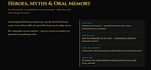 |

Պահանջ. ենթաբաժին բացելիս, օրինակ Art & Culture, երևան միայն իր ենթաբաժինները՝ մեծ, իրարից առանձնացված, առանց նկարագրության։

Սքրինշում ձախում `HEROES, MYTHS & ORAL MEMORY` է և ներքևում պարբերություն, աջում ենթակետերի ցանկ։

Ինչպես է արված. կատեգորիայի hub-ը մեծ քարտեր է, առանց քարտի պարբերության և առանց վերնագրի տակի ներածական տեքստի։

Ստուգել. `/culture/heritage` և `/culture/legends`։ Երևում են միայն ենթաբաժնի քարտերը, առանց նկարագրության։

Ֆայլեր. `components/culture-catalog/CultureCategoryPageView.tsx`, `components/culture-catalog/CultureCatalogSubcategoryGrid.tsx`

### B6 — User-ը նյութ չավելացնի

| | |
|---|---|
| Թերթ | տող 20, N 6, `remove` |
| % | 95% |
| Սքրինշ | 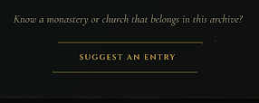 |

Պահանջ. օգտատերը ոչինչ ավելացնելու հնարավորություն չունենա, բոլոր add հնարավորությունները հանել։

Սքրինշ. «Know a monastery or church…» և կոճակ `SUGGEST AN ENTRY`։

Ինչպես է արված. հանրային ավելացնելու էջերը հանված են։ `/culture/submit` և `/culture/[categorySlug]/new` այլևս չեն բացվում։ Ադմինի նյութ ավելացնելը մնում է։

Ստուգել. կատալոգում `SUGGEST AN ENTRY` չկա։ `/culture/submit` և `/culture/architecture/new` 404 են։

Ֆայլեր. հանրային submit և `new` էջերը հանված են։ Ադմինը մնում է `/admin/culture-items/new`։

### B7 — Epic

| | |
|---|---|
| Թերթ | տող 21, N 7, `add` |
| % | 90% |
| Սքրինշ | չկա |

Պահանջ. Myths & Legends-ում ավելացնել epic։

Ինչպես է արված. Epic-ը Myths & Gods սյան վերջին կետն է, Legendaries & Heroes-ից հետո։ Էջը `/culture/legends/epic` է։

Ստուգել. հեդեր → Culture → Myths & Gods։ Epic-ը երրորդ կետն է և բացում է `/culture/legends/epic`։

Ֆայլեր. `lib/navigation/at-features-culture-menu.ts`

### B8 — Upcoming գումարները խմբագրելի

| | |
|---|---|
| Թերթ | տող 22, N 8, `upcomings` |
| % | 90% |
| Սքրինշ | չկա |

Պահանջ. upcoming projects-ը ադմինը խմբագրի, այդ թվում գումարը։

Ինչպես է արված. `Project` ունի `goalAmount` և `raisedAmount`։ Ադմինում ցանկ և խմբագրում կա։ Public էջը `/projects` է։

Ստուգել. `/admin/projects` փոխել գումարը, բացել `/projects`։ Նոր թիվը երևում է։

Ֆայլեր. `prisma/schema.prisma` (`Project`), `app/(admin)/admin/(panel)/projects/page.tsx`

### B9 — Why it matters և ամսական/տարեկան

| | |
|---|---|
| Թերթ | տող 23, N 9, `donation` |
| % | 95% |
| Սքրինշ | չկա |

Պահանջ. donations էջից հանել Why it matters։ Ամսական և տարեկան ենթաբաժանում չլինի։

Ինչպես է արված. Why it matters բլոկը էջում չկա։ Տարիֆը մեկ գումար է, ամիս/տարի փոխարկիչ չկա։ Slider-ը «AMD» է, ոչ թե ամսական ներդրում։

Ստուգել. `/donate`։ Why it matters չկա։ Քարտերին և slider-ին ամիս/տարի չկա։

Ֆայլեր. `components/donation-page/DonationPage.tsx`, `lib/constants/donation-page.ts`, `components/donation-page/DonationPatronSlider.tsx`

### B10 — Guardian / Ambassador / Magistr

| | |
|---|---|
| Թերթ | տող 24, N 10, `subscription` |
| % | 95% |
| Սքրինշ | չկա այս տողում (սերտիֆիկատի շարունակությունը B20-ն է) |

Պահանջ. օգտատերն ընտրի 1000 AMD (guardian), 5000 (ambassador), 10000 (magistr)։ Shortcut-ում միայն գումարը, առանց նկարագրության։ Վճարումների տակ երեք նկար և տվյալների դաշտեր, որ հետո սերտիֆիկատ ուղարկվի։

Ինչպես է արված. երեք տարիֆը 1000, 5000 և 10000 AMD են, քարտին միայն անունն ու գումարը։ Տակը երեք սերտիֆիկատի տեղ և անուն/էլ. փոստ/նշում դաշտեր։ Վճարման checkout-ը առանձին դրոշ է։

Ստուգել. `/donate`։ Երեք գումար, առանց նկարագրության։ Ներքևում երեք սերտիֆիկատ և ձև։

Ֆայլեր. `lib/constants/donation-page.ts`, `components/donation-page/DonationCertificateBlock.tsx`, `components/admin/page-content/forms/DonationPageContentForm.tsx`

### B11 — Ֆիլտրի գույները

| | |
|---|---|
| Թերթ | տող 25, N 11, `sections` |
| % | 95% |
| Սքրինշ | 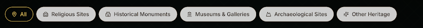 |

Պահանջ. միայն ընտրված բաժինը մոխրագույն, մյուսները սև՝ ոսկեգույն տառերով։

Սքրինշ. `All` (ընտրված, բաց) և `Religious Sites`, `Historical Monuments`, `Museums & Galleries`, `Archaeological Sites`, `Other Heritage`։

Ինչպես է արված. ընտրված ֆիլտրը բաց մոխրագույն է՝ մուգ տեքստով և ոսկե եզրով։ Մնացածը սև ֆոն են՝ ոսկե տեքստով։

Ստուգել. `/map`։ Սեղմել մեկ ֆիլտր. ընտրվածը բաց է, մյուսները սև ու ոսկեգույն։

Ֆայլեր. `components/map/MapFilterBar.tsx`

### B12 — Ցանկը քարտեզի մեջ

| | |
|---|---|
| Թերթ | տող 26, N 12, `map` |
| % | 95% |
| Սքրինշ | 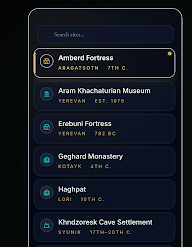 |

Պահանջ. այս հատվածը լինի հենց քարտեզի մեջ, քարտեզը հնարավորինս մեծ։

Սքրինշ. որոնման դաշտ և ցանկ (Amberd Fortress, Արամ Խաչատրյանի թանգարան, և այլն)։

Ինչպես է արված. որոնումը, առաջարկների ցանկը և ֆիլտրերը քարտեզի վրա են։ `/map` քարտեզը լցնում է մնացած էկրանը։

Ստուգել. `/map` desktop։ Ֆիլտրն ու որոնումը քարտեզի վրա են։ Քարտեզը էջի մեծ մասն է։

Ֆայլեր. `components/map/MapPanel.tsx`, `app/(public)/map/page.tsx`

### B13 — Բլոգը աշխատում է

| | |
|---|---|
| Թերթ | տող 27, N 13, `blog` |
| % | 95% |
| Սքրինշ | չկա |

Պահանջ. «բլոգը ոնց որ չի աշխատում»։

Ինչպես է արված. `/blog` ցույց է տալիս հրապարակված գրառումները, կատեգորիայի ֆիլտրը և յուրաքանչյուր գրառման էջը։ Դատարկ ցանկը դատարկ վիճակ է, ոչ թե կոտրված էջ։ Դասավորությունը B21-ն է։

Ստուգել. `/blog` և `/blog/report`։ Նոր գրառում՝ `/admin/blog/new`, status published։

Ֆայլեր. `app/(public)/blog/page.tsx`, `components/blog/BlogGrid.tsx`

### B14 — Միատոն սև ֆոն

| | |
|---|---|
| Թերթ | տող 28, N 14, `background` |
| % | 90% |
| Սքրինշ | 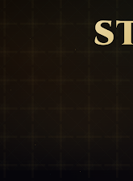 |

Պահանջ. Donate էջի այս ֆոնը մնացել է AI տարբերակից։ Բոլոր էջերում դարձնել միատոն սև։

Սքրինշ. մուգ ֆոն, բաց ցանց, աջում ոսկեգույն `ST` տառեր։

Ինչպես է արված. հանրային էջի ֆոնը սև է։ Donate-ի ցանցն ու շողքը, գլխավորի radial/grid-ը, քարտեզի և մուտքի ցանցը հանված են։ Hero-ի լուսանկարը մնում է։

Ստուգել. `/donate` և `/`։ Էջի ֆոնը հարթ սև է, առանց սքրինշի ցանցի։

Ֆայլեր. `components/sections/HomeHeritageSections.tsx`, `components/donation-page/donation-page.css`

### B15 — Sign in

| | |
|---|---|
| Թերթ | տող 29, N 15, `sign in` |
| % | 90% |
| Սքրինշ | չկա |

Պահանջ. տեղադրությունը շատ լավ է, ֆոնը իրենք կտան։

Ինչպես է արված. ձևը `/login`-ում կենտրոնում է։ Թերթով ֆոնի նկար չի եկել, էջը հարթ սև է (B14), մինչև նկարը տրվի։

Ստուգել. `/login`։ Ձևը կենտրոնում է, մուտքը տանում է պրոֆիլ կամ նախորդ էջ։

Ֆայլեր. `app/(public)/login/page.tsx`

### B16 — Upcoming-ի ենթակետերը

| | |
|---|---|
| Թերթ | տող 30, N 16, `upcoming projects` |
| % | 95% |
| Սքրինշ | 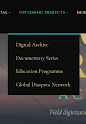 |

Պահանջ. հանել տարբերակները, որովհետև բաժինը ենթաբաժին չունի։

Սքրինշ. `UPCOMING PROJECTS` և տակը `Digital Archive`, `Documentary Series`, `Education Programs`, `Global Diaspora Network`։

Ինչպես է արված. Upcoming-ը մեկ հղում է դեպի `/projects`։ Նախագծերի վերնագրերը մենյուի տակ չեն։

Ստուգել. հեդեր → Upcoming Projects։ Բացվում է `/projects`, ենթացանկ չկա։

Ֆայլեր. `lib/navigation/build-projects-nav.ts`

### B17 — Գործընկերների էջ

| | |
|---|---|
| Թերթ | տող 31, N 17, `partnership page` |
| % | 95% |
| Սքրինշ | չկա |

Պահանջ. էջում միայն գործընկերների shortcut-ները։ Շրջանաձևը լավ չէ։ Մեկ նմուշ, նույնը բոլորին։

Ինչպես է արված. `/partnership` ցույց է տալիս միայն նույն ուղղանկյուն shortcut քարտերը։ Hero-ն, վիճակագրությունը և հայտի ձևը էջից հանված են։ Անուն չունեցող գործընկեր չի երևում։

Ստուգել. `/partnership`։ Քարտերը նույն չափի են, շրջան չեն։ Դատարկ քարտ չկա։

Ֆայլեր. `components/partnership-page/PartnershipPage.tsx`, `components/partnership-page/PartnershipShowcase.tsx`

### B18 — Գրքի ներբեռնում

| | |
|---|---|
| Թերթ | տող 32, N 18, `download` |
| % | 90% |
| Սքրինշ | չկա |

Պահանջ. հատված, որտեղից օգտատերը կարող է օրինակ գիրք ներբեռնել։

Ինչպես է արված. գլխավորի վերջում Downloads բաժինն է։ «Ներբեռնել PDF»-ը բացում է `/downloads/sample-heritage-primer.pdf`։

Ստուգել. `/#downloads`։ Սեղմել ներբեռնումը, ֆայլը PDF է։

Ֆայլեր. `components/sections/HeritageDownloadSection.tsx`

### B19 — Featured Treasures խառը դասավորություն

| | |
|---|---|
| Թերթ | տող 33, N 19, `FEATURED TREASURES` |
| % | 95% |
| Սքրինշ | չկա |

Պահանջ. հատվածը լավ է ստացվել, միայն դասավորությունը լինի խառը։

Ինչպես է արված. գլխավորի ցանցը խառը է. կան բարձր և սովորական տեղեր։ Կարգը ադմինի `featuredOrder` է։

Ստուգել. `/` → Featured Treasures։ Քարտերը մեկ հավասար շարք չեն։

Ֆայլեր. `components/sections/featured-treasures/FeaturedTreasuresGrid.tsx`

### B20 — Patron wall-ի փոխարեն սերտիֆիկատ

| | |
|---|---|
| Թերթ | տող 34, N 20, `subscription` |
| % | 95% |
| Սքրինշ | 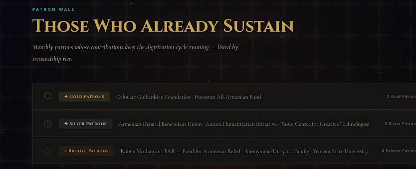 |

Պահանջ. հանել այս հատվածը։ Դնել երեք նկարի տեղ, որտեղ ադմինը դնում է սերտիֆիկատի շաբլոնները, և բլոկ, որտեղ օգտատերը լրացնում է տվյալները։

Սքրինշ. `PATRON WALL` / `THOSE WHO ALREADY SUSTAIN`, Gold / Silver / Bronze ցանկերով։

Ինչպես է արված. Patron wall-ը `/donate`-ից հանված է։ Սերտիֆիկատի երեք տեղը և ձևը մնում են վճարման բլոկի տակ։

Ստուգել. `/donate`։ «Those who already sustain» չկա։ Սերտիֆիկատի երեք տեղը կա։

Ֆայլեր. `components/donation-page/DonationPage.tsx`, `components/donation-page/DonationEngine.tsx`

### B21 — Բլոգի վերևի երեքը և ժամանակագրությունը

| | |
|---|---|
| Թերթ | տող 35, N 21, `բլոգ` |
| % | 95% |
| Սքրինշ | չկա |

Պահանջ. վերևում երեք highlighted, ներքևում թարմացումները ըստ ժամանակի։

Ինչպես է արված. `/blog` վերևում ցույց է տալիս մինչև երեք առանձնացված քարտ (`featuredOnHome`, պակասը լրացվում է ամենաթարմերով)։ Մնացածը ներքևում է՝ հրապարակման ամսաթվով։ Կատեգորիայի ֆիլտրը կիրառվում է երկու շարքի վրա։ Գլխավորի news բլոկը մնում է 1 մեծ + կողքի քարտեր։

Ստուգել. `/blog`։ Վերևում երեք քարտ, ներքևում ամսաթվով ցանկ։

Ֆայլեր. `app/(public)/blog/page.tsx`, `components/blog/BlogGrid.tsx`, `lib/blog-highlights.ts`

### B22 — Newsletter գրանցված օգտատիրոջը

| | |
|---|---|
| Թերթ | տող 36, N 22 |
| % | 90% |
| Սքրինշ | 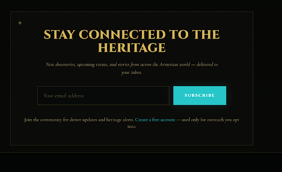 |

Պահանջ. landing-ից հանել այս բլոկը գրանցված օգտատերերի համար։

Սքրինշ. `STAY CONNECTED TO THE HERITAGE`, email դաշտ, `SUBSCRIBE`, և «Create a free account»։

Ինչպես է արված. այս բլոկը կոդում չկա, ոչ հյուրի, ոչ մուտք գործածի համար։ Պահանջից ուժեղ է. թաքցված չէ միայն գրանցվածներին, հանված է բոլորից։ Hero-ի login կոճակը առանձին է թաքնվում (B2)։

Ստուգել. `/` առանց մուտքի և մուտքով։ «Stay connected» չկա։

Ֆայլեր. `app/(public)/page.tsx`, `components/sections/HomeHeritageSections.tsx`

---

## C — մենյու, լեզու, քարտեզ, հաշիվ

### C1 — Մենյու ըստ կապված sheet-ի

| | |
|---|---|
| Թերթ | տող 38, N 1, `Menu Bar` |
| % | 90% |
| Սքրինշ | `screenshots/c1-menu.png` դատարկ շերտ է (20px), բովանդակություն չունի |

Պահանջ. մենյուն վերցնել միայն [այս կառուցվածքից](https://docs.google.com/spreadsheets/d/1Ynvib2KnK9PnUw0-Zny1rBPEUQtFFV_eTQYSf9kH-80/edit)։ Կարգը խախտված է, մի մասը վերանվանված է, մի մասը հանված։

Կապված sheet-ի սյուները.

- Architecture. Churches & Monasteries, Castles, Museums
- Myths & Gods. Mythology, Legendaries & Heroes
- Icons of History. Kings & Dynasties, Scientists & Inventors, Famous Armenians
- Art & Culture. Paintings, Music, Writers, Taraz, Carpets & Textile Arts
- More Culture. Sculptors, Theatre, Dance, Food & Drink, Publications
- Historical Highlights. Historical Events, Capitals, Battles & Wars, Christian Heritage, Chronicles & Manuscripts, Monuments & Landmarks, Traditions
- Առանձին. Heritage Map, Upcoming Projects, Partnership, Donation, About us (Mission, Team, Career, Contact)

Ինչպես է արված. Մնացած սյուները sheet-ի կարգով են։ B4-ը Museums-ը դրել է Art & Culture, B3-ը More Culture-ը խառնել է այդ սյան հետ, դրա համար առանձին More Culture սյուն չկա։ B7-ը Epic-ը դրել է Myths & Gods-ի վերջում։ Ornaments-ը մնում է Castles-ից հետո, որովհետև 09.10 թերթն է դա պահանջում։ Վերևի շարքում Blog-ը և Highlights-ը մնում են, որովհետև ավելի ուշ թերթերն ունեն այդ էջերը։

Ստուգել. հեդեր → Culture։ Հինգ սյուն, Museums-ը Art & Culture-ում, Epic-ը Myths & Gods-ում։ Armaments չկա։ `/culture/heritage/armaments` 404 է։

Ֆայլեր. `lib/navigation/at-features-culture-menu.ts`, `lib/navigation/merge-live-mega-menu.ts`

### C2 — Լոգո

| | |
|---|---|
| Թերթ | տող 39, N 2, `Logo` |
| % | 90% |
| Սքրինշ | 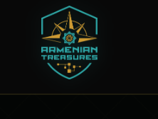 |

Պահանջ. մեծացնել լոգոն, որ երևա վահանի սիմվոլիկան։

Սքրինշ. վեցանկյուն վահան, փիրուզ և ոսկի, տակը `ARMENIAN TREASURES`։

Ինչպես է արված. `header-logo.webp`-ն ինքը այդ վահանն է՝ փիրուզ եզր, ոսկե աստղ, «ARMENIAN TREASURES»։ Հեռախոսում բարձրությունը `5.5rem` է, պլանշետում `7.5rem`, լայն էկրանին `8rem` (`--site-header-logo-height`), ոսկե ստվերով։ Սեղմելը տանում է գլխավոր։

Ստուգել. `/` հեդեր, desktop և mobile։ Վահանը կարդացվում է առանց մոտեցնելու։ Սեղմելը բացում է `/`։

Ֆայլեր. `components/brand/Logo.tsx`, `app/globals.css`, `public/images/brand/header-logo.webp`

### C4 — Իկոններ

| | |
|---|---|
| Թերթ | տող 40, N 4, `Icons` |
| % | 90% |
| Սքրինշ | 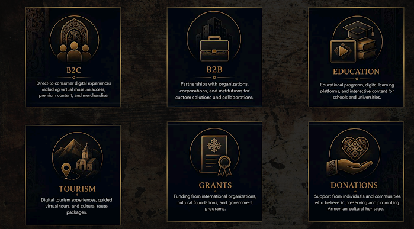 |

Պահանջ. պատուհանների իկոնները չոր են և փիրուզ։ Լինեն ոսկեգույն, հայկական զարդանախշով, պրեզենտացիայի նման։ Պրեզենտացիա՝ [Drive](https://drive.google.com/file/d/10VTjoz6Uug9xhJbDyKNkyaFix6UzQVnI/view)։

Սքրինշը նմուշն է. B2C, B2B, Education, Tourism, Grants, Donations, ոսկե գծանկար սև քարտի վրա։

Ինչպես է արված. Culture մենյուի կետերը ոսկե զարդանախշ իկոն են (`CultureOrnamentalIcon`)։ Կատալոգի քարտի վայրի տողը ոսկեգույն է, 3D նշանն էլ արդեն ոսկի էր։ Սքրինշի վեց քարտը առանձին էջ չէ. դա ոճի նմուշ է, ոչ թե գլխավորի բաժին։

Ստուգել. հեդեր → Culture, և `/culture/heritage`։ Իկոնները ոսկի են, ոչ թե փիրուզ Lucide։

Ֆայլեր. `components/icons/CultureOrnamentalIcon.tsx`, `components/culture-catalog/CultureCatalogItemGrid.tsx`

### C5 — Լեզուներ և enable/disable

| | |
|---|---|
| Թերթ | տող 41, N 5, `Language` |
| % | 90% |
| Սքրինշ | 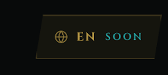 |

Պահանջ. հայերեն, ռուսերեն, անգլերեն, ֆրանսերեն, պորտուգալերեն։ Տեքստը կտան իրենք, կամ կլցնեն ադմինից։ Ֆրոնտում լեզուն հնարավոր լինի միացնել և անջատել։

Ինչպես է արված. հինգ լեզուն էլ կա, գումարած արևմտահայերենը (A3)։ `/admin/settings` նշում է, թե որ լեզուն երևա անջատիչում։ Անջատված լեզուն հեդերում չկա։ Տեքստը լրացվում է ադմինի լեզվի թաբերից. դատարկ դաշտը բովանդակության պակաս է, ոչ թե բացակա հնարավորություն։

Ստուգել. `/admin/settings` անջատել ֆրանսերենը, պահպանել, թարմացնել հեդերը։ FR չկա։ Նորից միացնել։

Ֆայլեր. `lib/i18n/locale-config.ts`, `components/admin/SiteLocaleSettingsField.tsx`, `components/navigation/LanguageSelector.tsx`

### C6 — Գլխավորի սեկցիաների կարգ

| | |
|---|---|
| Թերթ | տող 42, N 6, `Home page` |
| % | 90% |
| Սքրինշ | չկա |

Պահանջ. Hero, Statistic widget, Website features explorer, Interactive map, Culture fields icons, News feed, Upcoming highlights, Partnership icons footer։ Նմուշը Figma-ի hero էջն է։

Ինչպես է արված. կարգը՝ hero (վիճակագրությունը ներսում), քարտեզ, մշակույթի իկոններ, featured, news, upcoming, գրքի ներբեռնում, partnership լոգոներ։ Features explorer-ը գլխավորում չկա, որովհետև B1-ը հանել է այդ չորս քարտը։ Donate բլոկ գլխավորում չկա։

Ստուգել. `/` վերևից ներքև։ Partnership շարքը վերջում է, եթե գործընկեր կա։

Ֆայլեր. `components/sections/HeroHome.tsx`, `components/sections/HomeHeritageSections.tsx`

### C7 — Կենդանի ֆոն

| | |
|---|---|
| Թերթ | տող 43, N 7, `Visualisation` |
| % | 80% |
| Սքրինշ | չկա |

Պահանջ. էջը դատարկ և ստատիկ է։ Թեմային ֆոներ, որ կայքը խորը զգացվի։ Նկար կարող են տալ։

Ինչպես է արված. Գլխավորի, կատալոգի, նվիրատվության և մյուս landing-ների արդեն եղած լուսանկարը դանդաղ շարժվում է (`hero-photo-drift`)։ Նեղ էկրանին և `prefers-reduced-motion` դեպքում կանգ է առնում։ Սեկցիաների մարմինը հարթ սև է (B14), որովհետև նոր ֆոնի նկար չի տրվել։ Ցանցն ու շողքը չեն վերադարձվել։

Ստուգել. `/` և `/culture/heritage` լայն էկրանին։ Hero-ի նկարը կամաց մեծանում է։ Մնացած էջը սև է, առանց ցանցի։

Ֆայլեր. `components/sections/hero/HeroBackground.tsx`, `components/sections/hero/HeroImageOverlay.tsx`, `app/globals.css`

### C8 — Իմերսիվ քարտեզ

| | |
|---|---|
| Թերթ | տող 44, N 8, `the map` |
| % | 90% |
| Սքրինշ | չկա |

Պահանջ. քարտեզի հիմքը դեռ կտան։ Մինչ այդ՝ ավելի թվային, էֆեկտներով, անիմացիայով, ինտերակտիվ pin-երով։

Ինչպես է արված. `/map` Leaflet է, pin-ը բացում է նյութը, կա որոնում և ֆիլտր։ Սալիկները մգացված են և գույնը հանված է, որ քարտեզը թվային կարդացվի, ոչ թե սովորական փողոցային քարտեզ։ Pin-ը hover-ին բարձրանում է, ընտրվածը օղակ է անում։ `prefers-reduced-motion` դեպքում pin-ի շարժումը կանգ է առնում։ Սեփական հիմքը դեռ իրենց կողմից է. այս շերտը ժամանակավոր է։

Ստուգել. `/map`։ Քարտեզը մուգ է, առանց վառ փողոցային գույների։ Pin սեղմելը բացում է քարտը, ընտրված pin-ի տակ օղակ կա։

Ֆայլեր. `components/map/LeafletMap.tsx`, `components/map/leaflet-markers.css`

### C11 — Մոբայլ

| | |
|---|---|
| Թերթ | տող 45, N 11, `Mobile version` |
| % | 90% |
| Սքրինշ | չկա |

Պահանջ. մոբայլն ավելի չոր է և դանդաղ, տեքստը նորմալ բացվում է։

Ինչպես է արված. հեռախոսի հեդերը `5.5rem` է, որ վահանը երևա և էջը չուտի։ Մենյուի երկար անունները տողափոխվում են, չեն կտրվում էկրանից դուրս։ Վերնագրերը `overflow-wrap: break-word` են, ոչ թե բառի մեջտեղից։ Մենյուի blur-ը հանված է, որ բացվելը չծանրանա։ Hero-ի շարժումը նեղ էկրանին կանգ է առնում։

Ստուգել. `/` և `/culture/heritage` 390px լայնքով։ Մենյուն բացվում է, երկար անունը մնում է էկրանի մեջ։

Ֆայլեր. `components/navigation/MobileMenu.tsx`

### C12 — Բաժինների կապը

| | |
|---|---|
| Թերթ | տող 46, `connections` |
| % | 90% |
| Սքրինշ | չկա |

Պահանջ. եկեղեցիներից կարելի է վերադառնալ ճարտարապետություն, բայց ճարտարապետություն բաժինն ինքը ընտրելի չէ։

Ինչպես է արված. `/culture/architecture/churches` breadcrumb-ի Architecture-ը հղում է `/culture/architecture`։ Մենյուի սյան վերնագիրը նույն էջն է բացում։ Այդ էջը ենթաբաժինների ցանց է, ոչ թե փակուղի։

Ստուգել. `/culture/architecture/churches` → breadcrumb-ի Architecture → `/culture/architecture`։ Նույնը մենյուի սյան վերնագրով։

Ֆայլեր. `lib/culture-catalog/build-culture-breadcrumb.ts`, `lib/navigation/at-features-culture-menu.ts`

### C13 — News feed

| | |
|---|---|
| Թերթ | տող 47, `news feed/blog` |
| % | 90% |
| Սքրինշ | չկա |

Պահանջ. առանձին news/blog, որտեղ երևա ինչ է արվել գումարով։ Տեղը մոտավորապես Donation-ի և About-ի միջև։ Վիդեո, նկար, տեքստ։ Հնարավորության դեպքում Meta, one click հրապարակում։

Ինչպես է արված. `/blog` և գլխավորի news սեկցիան կան։ Ադմինը գրառմանը դնում է կազմ, տեքստ, վիդեո կամ պատկեր։ Գրառումը featured-ով ընկնում է գլխավոր։ Հրապարակված գրառման վրա «Կիսվել Facebook-ում» բացում է Facebook-ի պատուհանը այդ հասցեով, մեկ սեղմումով։ Նույն կոճակը կա ադմինի խմբագրման էջում։ Դիրքը գլխավորի featured-ից հետո է. Donation-ի բլոկ գլխավորում չկա։

Ստուգել. `/admin/blog` բացել հրապարակված գրառում, սեղմել Share on Facebook։ Հանրային `/blog/[slug]` նույն կոճակը բացում է `facebook.com/sharer` նոր ներդիրով։

Ֆայլեր. `components/blog/BlogDetailView.tsx`, `lib/blog-share.ts`, `app/(admin)/admin/(panel)/blog/[id]/page.tsx`

### C14 — Գրանցում

| | |
|---|---|
| Թերթ | տող 48, `add registration section` |
| % | 90% |
| Սքրինշ | չկա |

Պահանջ. գրանցում, որ օգտատերերին հետևեն և հանգանակության outreach անեն։

Ինչպես է արված. `/register`, `/login`, `/profile` կան։ Ադմինը տեսնում է օգտատերերին `/admin/users` և անդամի նվիրատվությունները `/admin/member-donations`։ Նույն էջում երևում է քանի գրանցված դեռ չի նվիրաբերել, և նրանց էլփոստները մեկ սեղմումով պատճենվում են։ Նամակը ուղարկվում է ադմինի սեփական փոստից. կայքում փոստի ծառայություն միացված չէ։

Ստուգել. `/register` ստեղծել հաշիվ, մտնել `/profile`։ Ադմինում `/admin/users` նոր տողը երևում է, «Copy emails for outreach» պատճենում է դեռ չնվիրաբերածների հասցեները։

Ֆայլեր. `app/(public)/register/page.tsx`, `app/(admin)/admin/(panel)/users/page.tsx`, `components/admin/MemberOutreachCopy.tsx`

---

## Ամփոփումը թերթում

Տող 50-ը task չէ։ Հաճախորդի ամփոփումը չորս թեմա է. վիզուալներ, նկարների պակաս, կառուցվածք, քարտեզի տեսլական։ Դրանք ծածկում են C2, C4, C7, C1, C8։
